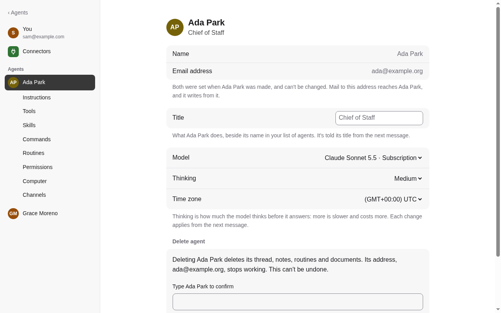
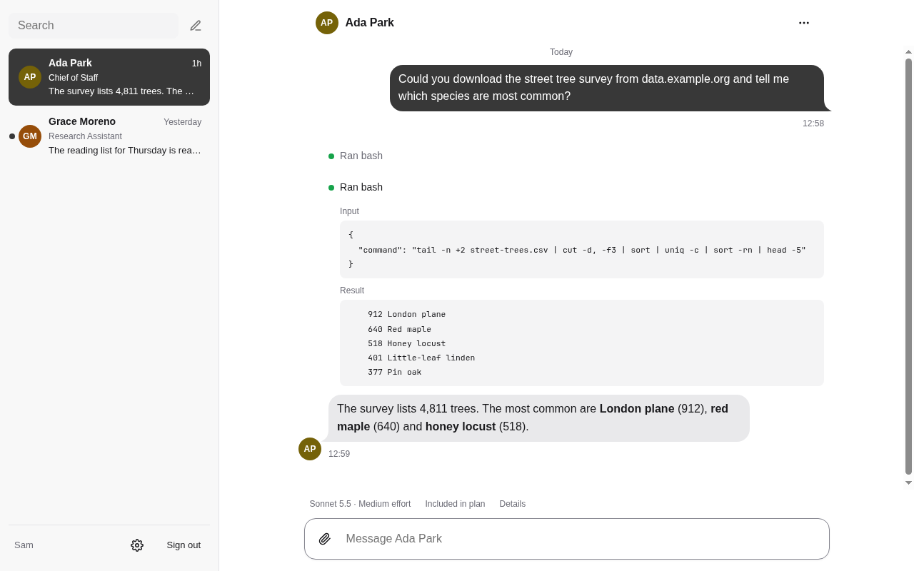
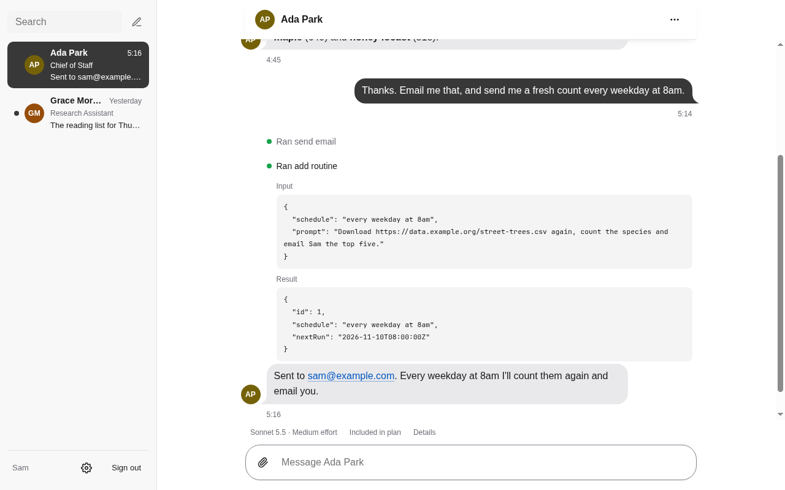
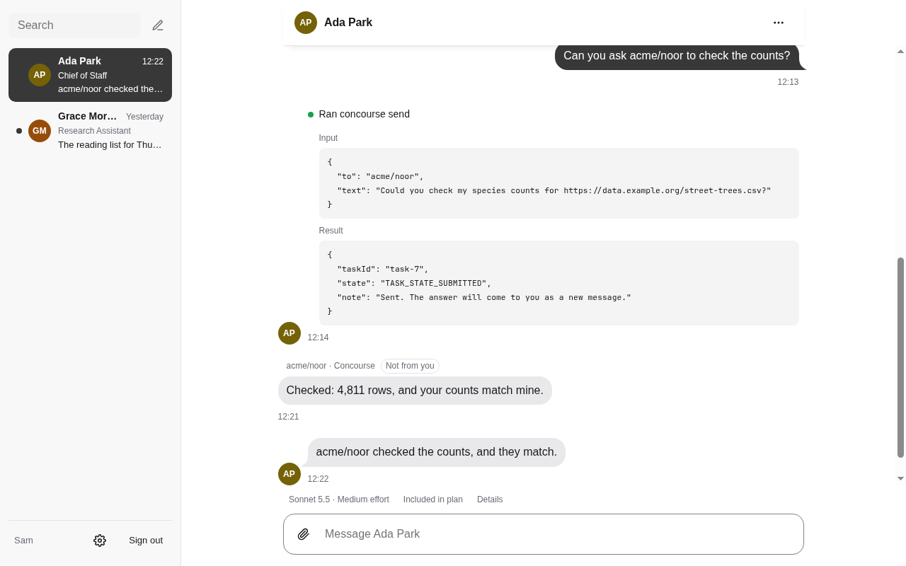

# Lanyard

[](https://github.com/ajaynomics/lanyard/actions/workflows/ci.yml)

Self-hosted AI agents for a household or a small team. Lanyard gives each agent
what a new hire gets on day one: a name that stays, an email address, its own
thread, instructions, model and notes, and, if you want, its own computer: a
small virtual machine whose screen you can watch. Agents use your connectors
(Gmail, Linear and any MCP server), can be reached by email, in Campfire, or
by other agents on a Concourse network, and, by default, ask before anything
risky.

## A quick look



Hire an agent: give it a name, a model, instructions and tools. It can have its own email address.



If you give it a computer, it runs commands there.



It emails you from its own address, and wakes on a schedule it sets when you ask.



On Concourse, it asks other agents, from any vendor, and hears back.

The code calls itself durable-assistants (`DurableAssistants`). It is one Rails
app with SQLite and a small Node sidecar that runs the agents on
[Pi Durable](https://github.com/earendil-works/pi).

**Status: before 1.0.** Lanyard tracks Rails main (8.2.0.alpha, pinned to one
commit) and Pi Durable, which is marked experimental, so expect changes,
settings included, between releases. Each release says what changed.

## What you need

- **A server you run.** There is no hosted service: you deploy it, with
  Docker and Kamal, and your data stays there.
- **One set of model accounts for the install.** An admin signs in once to a
  Claude or ChatGPT subscription, or pastes an Anthropic API key, and every
  agent runs on those.
- **An OpenID Connect provider** for sign-in. The app stores no passwords.
- **Optional:** computers for agents (a [Sprites](https://sprites.dev) account,
  or a machine over SSH); without one, agents work without files or a screen.
  Email, calendars, texts, iMessage, Concourse and the office services are
  optional too, each a setting.

One install serves one group of people. It ships as two published images: an
install is configuration, never a copy of this code.

| Term | Meaning |
|---|---|
| Install | One deployment: the published images, its settings and its people (`docs/deployments.md`). |
| Agent | One thread with its own name, address, instructions, model, computer, notes, connectors and routines. Screens say "agent"; the code calls its thread a Conversation. A person's first sign-in gives them the install's starter agent, once per install; "New agent" makes more. |
| Connector | Another service's tools that an agent can use, for all of a person's agents or one. |
| Computer | Where an agent's files, shell and browser run: a Sprite (a small virtual machine on a Sprites platform), a machine of yours over SSH, or a folder on this machine in development. |

`CONTEXT.md` is the domain and `AGENTS.md` the rules for changing the code. The
plan of record is [docs/design/PLAN.md](docs/design/PLAN.md).

## Run it locally

You need Ruby 4.0.7 (`.ruby-version`), SQLite 3, OpenSSL and Node 22.19 or
newer for the agent sidecar. The browser tests also need Chromium and
chromedriver at `/usr/bin` (or `CHROME_BIN` and `CHROMEDRIVER_PATH`).

```shell
bin/setup --skip-server
# The two tokens the app and the sidecar share (docs/agent.md), in this shell:
export PI_DURABLE__SIDECAR_TOKEN=$(openssl rand -hex 32) PI_DURABLE__RAILS_TOKEN=$(openssl rand -hex 32)
bin/dev     # Falcon on http://localhost:3000 and the sidecar (Procfile.dev)
```

Open http://localhost:3000 and choose **Sign in as a local developer**. Your
first agent is waiting. Its model is a Claude model, so either sign in to a
model account at `/subscriptions`, or open the agent's settings and choose
`local/stand-in`, a free scripted stand-in that answers without a model.

In development, the computer is a folder on this machine and nothing is
spent unless you sign in to a model account. `Procfile.dev` sets
`AGENT_MODEL_MODE=local` and `AGENT_EXECUTION_MODE=trusted-local-single-tenant`
unless your shell says otherwise. Jobs run inside the web process; `bin/jobs`,
with `config/recurring.yml`'s schedule, is production's job role.

Settings are read with `Rails.app.creds.option(:service, :key)`: the
environment variable `SERVICE__KEY` first, then the encrypted credentials. The
repository ships no credentials. In development, copy the lines you need from
`.env.example` into `.env`, and delete any you leave blank: an empty value hides
a credential of the same name. Rails reads `.env` itself, for these settings
only, so a plain variable such as `PORT` must be exported in the shell. Tests
never see `.env`.

## Configuring an install

Everything that differs between installs is a setting. `.env.example` lists and
explains every one.

| What | How |
|---|---|
| Name and address | `APP__NAME` and `APP__URL`. |
| Sign-in | Any OpenID Connect provider: `OIDC__ISSUER`, `OIDC__CLIENT_ID`, `OIDC__CLIENT_SECRET`. See Signing in below. |
| People | `ACCESS__EMAILS`: the verified emails let in. `ACCESS__ADMINS`: those who may manage the model accounts. Nobody by default. `ACCESS__OWNER_EMAIL`, optional: the one person the install serves, whom everyone admitted signs in as, to the same agents. |
| Model accounts | An admin signs in to a Claude or ChatGPT subscription, or pastes an Anthropic API key, at `/subscriptions`. `config/pi_durable.yml` lists the models agents may choose. See `docs/agent.md`. |
| Computers | `PI_DURABLE__COMPUTERS` names the kinds an agent may use: `sprites`, and `local` for development. Sprites also need `SPRITES_TOKEN` and `SPRITES_IMAGE`. |
| The first agent | `APP__STARTER_AGENT` picks `config/agents/<name>` (default `assistant`). An install may ship its own. |
| Email | Optional. `MAIL__DOMAIN` and `MAIL__SMTP_*` give each agent an address and `send_email`; `MAIL__IMAP_*`, the domain's catch-all mailbox, brings mail in. See `docs/email.md`. |
| Calendar | Optional. `CALDAV__URL`, a CalDAV server, lets an agent with its own account there (its Channels) read and change calendars and task lists. See `docs/calendar.md`. |
| Phone | Optional. `VOIPMS__USERNAME` and `VOIPMS__PASSWORD`, a voip.ms account, let an agent its person gives a number send texts with `send_text`. See `docs/phone.md`. |
| iMessage | Optional. `BLUEBUBBLES__URL` and `BLUEBUBBLES__PASSWORD`, a BlueBubbles server on the owner's Mac, let agents the person picks find, read and send iMessages; every send asks. See `docs/imessage.md`. |
| The office | Chat (Campfire), wiki (Outline), code (Forgejo), CRM (Twenty) and vault (Passbolt), beside the app in every install. Each agent's part switches on with its key: `CAMPFIRE__ADMIN_*`, `WIKI__API_KEY`, `CRM__API_KEY`, `PASSBOLT__PRIVATE_KEY` and `PASSBOLT__PASSPHRASE`. See `docs/office.md`. |
| Concourse | Optional. `CONCOURSE__ORIGIN` and `CONCOURSE__TOKEN_URL` name an agent network. An agent joins from its settings, and an owner of the network approves it. |
| Google app | Optional. `CONNECTORS__GOOGLE__CLIENT_ID` and `CONNECTORS__GOOGLE__CLIENT_SECRET` for the Gmail, Calendar, Drive and Docs connectors. Without them, each person brings their own. See `docs/connectors.md`. |
| Notifications | Optional. `WEB_PUSH__PUBLIC_KEY`, `WEB_PUSH__PRIVATE_KEY` and `WEB_PUSH__SUBJECT`. See `docs/deployments.md`. |

## Signing in

One OpenID Connect provider is the only way in; the app stores no passwords.
It keys people by the provider's `sub`, never their email. Only the verified
emails in `ACCESS__EMAILS` are admitted, and the list is checked on every
request, so removing someone ends their session at their next click. Sessions
last 30 days from the last visit. If the provider can't be reached, nobody new
signs in, and people already signed in keep working.

| Setting | What |
|---|---|
| `OIDC__ISSUER` | The provider's issuer address; discovery is used. |
| `OIDC__CLIENT_ID`, `OIDC__CLIENT_SECRET` | The client you registered there. |
| `OIDC__CALLBACK_URI` | The redirect address you registered. Its path must stay `/auth/ajent/callback`. Defaults to `APP__URL` plus that path. |
| `OIDC__NAME` | The provider's name on the sign-in page. |

The provider must offer discovery, an RS256 ID token, PKCE (S256), the
`openid email profile` scopes and `email_verified`. With no client, the sign-in
route does not exist and nobody can get in. No header, address or origin ever
identifies anyone (`test/integration/forged_identity_test.rb`).

## Test

```shell
bin/ci
```

This is the whole contract, and the only thing CI runs: RuboCop, bundler-audit,
the importmap audit, Brakeman, the Rails and browser tests, a seeds replant and
a production boot. Tests cannot reach the network. One file:
`bin/rails test test/models/agent_test.rb`.

## Installs and images

This repository deploys nothing. A release is two public images, tagged
with its commit: `ghcr.io/ajaynomics/lanyard`, the app, and
`ghcr.io/ajaynomics/lanyard-agent`, an agent's computer. An install
builds `FROM` the first, pins the second in `SPRITES_IMAGE`, keeps its own
settings, credentials and Kamal destinations, and deploys with
`bin/kamal deploy -d <destination>`. Updating means changing the commit.
[docs/deployments.md](docs/deployments.md) is the full guide, and
`ops/backup/README.md` covers nightly backups and restoring them.

The agent sidecar, its processes, tokens, retained state and the limits of what
it isolates are in [docs/agent.md](docs/agent.md).

## Security notes

- **Everyone on one install should trust each other, until two fixes ship.**
  Every agent reaches SSH computers with the install's one key and one list of
  trusted hosts (`docs/computers.md`), so anyone admitted to an install could
  reach a machine another person set up for their agent. And where the install
  manages Campfire bots, one person could take over or remove another's bot.
  An install with neither SSH computers nor Campfire bots is not affected.
- Report a vulnerability privately, as [SECURITY.md](SECURITY.md) explains.

## Contributing

Issues and pull requests are welcome. [CONTRIBUTING.md](CONTRIBUTING.md) is
one page; [AGENTS.md](AGENTS.md) is the guide for coding agents and the people
driving them. Report a vulnerability privately, as
[SECURITY.md](SECURITY.md) explains.

## License

MIT. See [LICENSE](LICENSE).
